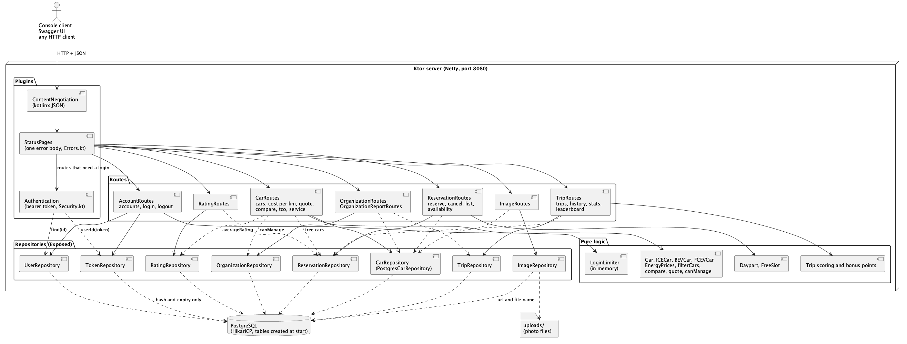

# rent-a-car

[](https://github.com/Rent-a-car-38291/rent-a-car/actions/workflows/build.yml)

A car rental backend for the Avans course: browse a fleet of petrol, electric and hydrogen cars, and register, log in and manage your account.

Built with [Ktor](https://ktor.io) and Kotlin, and the [Kotlin Toolchain](https://github.com/JetBrains/amper) (Amper).

## Features

- Cars of three kinds: combustion (`ICE`), battery electric (`BEV`) and hydrogen (`FCEV`), with a sample fleet
- Register, log in and out, and update or delete your own account, with bearer tokens for protected routes
- Cars and accounts are stored in PostgreSQL
- Passwords are stored hashed

## Getting started

You need a JDK and Docker. The `./kotlin` wrapper downloads the toolchain on the first run, so there is nothing else to install. On Windows, use `kotlin.bat` instead of `./kotlin`.

Start the database, then the server:

```bash
docker compose up -d
./kotlin run -m rent-a-car
```

The project has two modules (the server and the [console client](#console-client)), so `run` needs `-m` with the module to start. The server module is named after the folder you cloned into (`rent-a-car`); `./kotlin show modules` lists the names.

If the server starts successfully, you'll see:

```
2024-12-04 14:32:45.584 [main] INFO  Application - Application started in 0.303 seconds.
2024-12-04 14:32:45.682 [main] INFO  Application - Responding at http://0.0.0.0:8080
```

Try it:

```bash
curl http://localhost:8080/cars
```

| Command          | Description       |
|------------------|-------------------|
| `./kotlin run -m rent-a-car` | Run the server |
| `./kotlin run -m cli` | Run the console client |
| `./kotlin test`  | Run the tests of both modules |
| `./kotlin build` | Build both modules |

### Tests

`./kotlin test` runs everything; a single class runs with `./kotlin test --include-classes=com.example.cars.CarFilterTest`.

- **Unit tests** check one piece of logic and need no server or database: `CarFilterTest`, `AddCarRequestTest`, `CostPerKmTest`, `QuoteTest`, `TcoTest`, `TripScoreTest`, `TripDurationTest`, `DaypartTest`, `FreeSlotTest`. They run in milliseconds.
- **Integration tests** (the route and repository tests) start the application with `testApplication` and a real Postgres that the tests start themselves, and check status codes and what ends up in the database. `CarAccessTest` is a unit test of the access rules that uses that Postgres for the memberships.
- **Console client tests** (`cli/test`): the menus with scripted input and a fake API, the error messages, and `EndToEndTest`, which starts the real server on a random port with its own Postgres and drives register, list cars, reserve, trip and leaderboard through the real HTTP client.

A rule gets a unit test for each edge value; a route gets an integration test for each status code it can answer.

The connection defaults match `docker-compose.yml`. Override them with the environment variables `DATABASE_URL`, `DATABASE_USER` and `DATABASE_PASSWORD`. Car photos are stored as files in the directory `uploads` (set `IMAGES_DIRECTORY` to change it), next to the database rows that hold their urls. The tables are created when the server starts, and the cars table is filled with sample cars when it is empty. Login tokens are not stored: after a restart everyone logs in again. The tests don't need Docker: they start their own Postgres.

## Console client

`cli/` is a small client that talks to the running server over HTTP, so the whole application can be demoed without a frontend. It is a separate Amper module next to the server (`project.yaml` lists both): that keeps the client's code out of the server, needs no new dependency (it uses the JDK's HTTP client and kotlinx.serialization, which the project already has), and lets `./kotlin test` and `./kotlin build` cover both. The cost is that `./kotlin run` now needs `-m <module>`.

```bash
./kotlin run -m cli                                  # talks to http://localhost:8080
RENT_A_CAR_URL=http://localhost:9000 ./kotlin run -m cli   # another server (or pass the url as the first argument)
```

Start screen: register, log in, browse as a visitor (the car list, availability, costs and the leaderboard need no login) or quit. After login the main menu has the areas **Cars** (search, details with photos and ratings, availability, offer, update and delete your car), **Costs** (cost per km, quote, TCO), **Reservations** (reserve, cancel), **Trips** (start, end, record in one go, history, rate), **Insights** (leaderboard, your stats), **Account** (update, password, delete) and **Organizations** (create, invite, join, roles, leave, organization cars). Type `back` at any prompt to cancel the action; `0` goes one menu up. Cars are picked from a numbered list, dates are `YYYY-MM-DD` and dayparts are picked from a list.

The token is only kept in memory and the passwords are echoed while typing (`shortcut:` plain stdin). The API has no "who am I", no list of your reservations or organizations and no list of members, so the client shows the account id when you register (it asks for it once if you only log in) and keeps the reservations and organizations you made during the run for its pickers; others can be typed by id. Photo upload, comparing cars and listing members are not in the client.

### Adding a menu entry

Each area is one file in `cli/src/areas/` that defines a `Menu` of `MenuItem`s; `cli/src/Areas.kt` lists the areas.

1. New endpoint in an existing area: add a `MenuItem("Label") { ctx -> ... }` to that file's list. Inside, prompt with `ctx.io` (`text`, `int`, `double`, `date`, `choose`, `optionalText` ...), call the API with `ctx.call("GET", "/path", query, body, hints)` and print the answer with `ctx.io.table(...)` or `ctx.io.show(...)`. `ctx.call` already shows a friendly message for `400`, `401`, `403`, `404` and `409` (`hints` replace the text of a code for this action) and returns `null` then. Pickers: `ctx.pickCar()`, `ctx.pickReservation()`, `ctx.pickOrganization()`.
2. New area: copy a file from `areas/`, name the `Menu`, and add it to the list in `Areas.kt`.
3. `MenuItem(needsLogin = false)` keeps an item visible to visitors; the default hides it until login.

```kotlin
MenuItem("Cost per km of a car", needsLogin = false) { ctx ->
    val id = ctx.pickCar() ?: return@MenuItem
    ctx.call("GET", "/cars/$id/cost-per-km")?.let { ctx.io.show(it.jsonObject) }
}
```

Menus only use the `Api` interface and the injected `Console`, so tests drive them with scripted input and a fake API (`cli/test/FakeApi.kt`); `EndToEndTest` runs the client against the real server and a real Postgres.

### Demo walkthrough

About two minutes, with two terminals:

```bash
docker compose up -d
./kotlin run -m rent-a-car      # terminal 1: the server
./kotlin run -m cli             # terminal 2: the client
```

1. **Register** (name, email, a password of 8+ characters). You are logged in and the main menu opens.
2. **Cars > List and search cars**: press Enter on every filter to see the fleet; try type `BEV`. **Car details** shows photos and ratings.
3. **Costs > Quote a trip**: pick a car and a distance. **Cost per km** shows the energy price.
4. **Reservations > Reserve a car**: pick a car, press Enter for today and pick a daypart.
5. **Trips > Start my trip**, then **End my trip** (distance, hard accelerations, hard brakes): you earn bonus points. **Rate the car** afterwards.
6. **Insights > Leaderboard** and **My driving stats** show your points.
7. **Organizations > Create an organization**, then **Invite someone** for a code; a second client (register another account) can **Join with an invite code**.
8. `0` to **Log out**, `0` to **Quit**.

## Trying the API (Swagger UI)

With the server running, open [http://localhost:8080/swagger](http://localhost:8080/swagger) to see every endpoint and try it with "Try it out". The page is described by [`resources/openapi/documentation.yaml`](resources/openapi/documentation.yaml), so add new endpoints there as well.

Swagger UI is only served in Ktor's development mode, which is on by default. Start the server with `KTOR_DEVELOPMENT=false` to turn it off.

## API

| Method   | Path                      | Description                    | Success | Errors                            |
| -------- | ------------------------- | ------------------------------ | ------- | --------------------------------- |
| `GET`    | `/cars`                   | List cars, optionally free on a date and daypart | `200` | `400`                    |
| `POST`   | `/cars`                   | Offer a car                    | `201`   | `400`, `401`, `403`, `409`        |
| `PUT`    | `/cars/{id}`              | Update a car you may manage    | `200`   | `400`, `401`, `403`, `404`, `409` |
| `DELETE` | `/cars/{id}`              | Delete a car you may delete    | `204`   | `400`, `401`, `403`, `404`        |
| `GET`    | `/cars/{id}/cost-per-km`  | Energy cost of one km          | `200`   | `400`, `404`                      |
| `GET`    | `/cars/{id}/quote`        | Quote a trip before reserving  | `200`   | `400`, `404`                      |
| `GET`    | `/cars/{id}`              | Get a car with its photo urls  | `200`   | `400`, `401`, `404`               |
| `POST`   | `/cars/{id}/images`       | Add a JPEG or PNG photo        | `201`   | `400`, `401`, `403`, `404`, `409`, `413` |
| `GET`    | `/images/{name}`          | Download a photo               | `200`   | `404`                             |
| `GET`    | `/cars/{id}/tco`          | Total cost of ownership a year | `200`   | `400`, `401`, `403`, `404`        |
| `POST`   | `/cars/{id}/reservations` | Reserve a car for a daypart    | `201`   | `400`, `401`, `404`, `409`        |
| `GET`    | `/cars/{id}/availability` | Free dayparts on a date        | `200`   | `400`, `404`                      |
| `DELETE` | `/reservations/{id}`      | Cancel your reservation        | `204`   | `400`, `401`, `403`, `404`, `409` |
| `POST`   | `/reservations/{id}/trip` | Record a trip, earn points     | `201`   | `400`, `401`, `403`, `404`, `409` |
| `POST`   | `/reservations/{id}/trip/start` | Start your trip          | `200`   | `400`, `401`, `403`, `404`, `409` |
| `POST`   | `/reservations/{id}/trip/end`   | End it, earn points      | `201`   | `400`, `401`, `403`, `404`, `409` |
| `GET`    | `/trips`                  | Your trip history              | `200`   | `400`, `401`                      |
| `GET`    | `/cars/{id}/trips`        | The trips of a car you manage  | `200`   | `400`, `401`, `403`, `404`        |
| `GET`    | `/accounts/{id}/stats`    | Your driving totals            | `200`   | `400`, `401`, `403`, `404`        |
| `GET`    | `/leaderboard`            | The drivers with most points   | `200`   | `400`                             |
| `POST`   | `/reservations/{id}/rating` | Rate the car after your trip | `201`   | `400`, `401`, `403`, `404`, `409` |
| `GET`    | `/cars/{id}/ratings`      | The ratings and average of a car | `200` | `400`, `404`                      |
| `POST`   | `/accounts`               | Register an account            | `201`   | `400`, `409`                      |
| `POST`   | `/login`                  | Get a token                    | `200`   | `401`                             |
| `POST`   | `/logout`                 | Revoke the token you used      | `204`   | `401`                             |
| `PUT`    | `/accounts/{id}`          | Update your own name and email | `200`   | `400`, `401`, `403`, `404`, `409` |
| `PUT`    | `/accounts/{id}/password` | Change your own password       | `204`   | `400`, `401`, `403`, `404`        |
| `DELETE` | `/accounts/{id}`          | Delete your own account        | `204`   | `400`, `401`, `403`, `404`        |

A car is rented per daypart: `MORNING` (06:00-12:00), `AFTERNOON` (12:00-18:00) or `EVENING` (18:00-24:00), once per car and date. Pass the `date` (`2026-10-12`) and `daypart` to `POST /cars/{id}/reservations`; `GET /cars/{id}/availability?date=2026-10-12` lists what is still free. `GET /cars?date=2026-10-12&daypart=MORNING` lists only the cars that are free then (not reserved, not in `Maintenance`) and combines with the other filters; `date` and `daypart` come together, and a missing, invalid or past value gives `400`. A car in `Maintenance` can't be reserved. There is no `Rented` status. The renter can cancel with `DELETE /reservations/{id}` until the daypart starts (its `from` time), after which, or once it has a trip or a started trip, the answer is `409`; the daypart is free again for anyone.

A car is private or belongs to an organization. `POST /cars` with an `organizationId` (you must be a member, else `403`) makes an organization car: it has no `ownerId`, every member can update it and see its TCO, and only an admin can delete it. Private cars are managed by their owner only. Deleting an account removes its private cars; organization cars stay.

Photos: `POST /cars/{id}/images` takes a multipart form with the photo in the part `file` (JPEG or PNG, up to 5 MB and 10 per car, `409` beyond that; whoever may manage the car). The server checks the file's first bytes instead of trusting its name or declared type, stores it under a random name and answers `{id, carId, url}`. `GET /cars/{id}` lists the urls in `images`, and every url serves the photo without a login. Deleting a car removes its photos too.

After driving, the renter sends the trip of their reservation to `POST /reservations/{id}/trip` with `distanceKm`, `hardAccelerations` and `hardBrakes` as the app measured them, once per reservation and not before its date. The server calculates the `score` (100, minus 5 for every hard acceleration or brake per 100 km, never below 0) and awards `distanceKm * score / 100` points (rounded down) to the renter's `bonusPoints`, which accounts show.

The app can also time the trip: `POST /reservations/{id}/trip/start` (on the day of the reservation, once) stores the start, and `POST /reservations/{id}/trip/end` with the same body as above ends it. The trip then has `startedAt` and `durationMinutes` (whole minutes, rounded up, at least 1), and the points are awarded as before. Ending a trip that was not started, or twice, gives `409`, and so does sending a started trip in one call; a trip sent in one call has both fields `null`.

`GET /trips` lists your own trips, newest first, with the car, date, daypart, `distanceKm` and `score`. `from` and `to` (ISO dates, inclusive) filter on the date of the reservation and `limit` (1-100, default 20) and `offset` page through the list; an invalid value gives `400`. `GET /cars/{id}/trips` does the same for everyone's trips with a car, for the owner of a private car or a member of the organization of an organization car (`403` for others).

`GET /accounts/{id}/stats` shows your driving totals: `tripCount`, `totalKm`, `averageScore` (one decimal), `bestDaypart` (the daypart with the highest average score, the earliest on a tie) and `bonusPoints`. `averageScore` and `bestDaypart` are `null` without trips. Only finished trips count, and it only works on your own account (`403` for someone else's, `404` for an unknown one).

`GET /leaderboard` is public and lists the drivers with the most bonus points, each with only a `name` and `bonusPoints` (never the email). `limit` (1-100, default 10) cuts the list and anything else gives `400`. Equal points are ordered by name and then by account, and users without points are not listed.

After a finished trip the renter can rate the car once with `POST /reservations/{id}/rating`: `stars` (1 to 5) and an optional `comment` (up to 500 characters, trimmed). `409` without a finished trip (a started trip that has not ended does not count) or when the reservation was already rated. `GET /cars/{id}/ratings` lists the ratings of a car, newest first, with `averageRating` (one decimal, `null` without ratings) and `ratingCount`; a rating shows no data of the renter. `GET /cars` and `GET /cars/{id}` also show the car's `averageRating`. Deleting a car or an account removes the ratings that belong to it.

A password needs 8 to 128 characters, and the email address must be unused. Everything under `/accounts/{id}` and `/logout` needs a login and only works on your own account. Routes that need a login take the token from `POST /login` in an `Authorization: Bearer <token>` header. Each endpoint has a [sequence diagram](docs/diagrams) with every status code.

```bash
curl -X POST localhost:8080/accounts -H 'Content-Type: application/json' \
     -d '{"name":"Sam","email":"sam@example.com","password":"correct horse"}'

curl -X POST localhost:8080/login -H 'Content-Type: application/json' \
     -d '{"email":"sam@example.com","password":"correct horse"}'
# {"token":"..."}
```

## Project layout

```
src/
├── Application.kt        wires the modules together
├── accounts/             users, login tokens, account routes
├── cars/                 the car hierarchy, repository and routes
└── database/             the PostgreSQL connection
resources/                server configuration and the SQL that creates the tables
test/                     mirrors src/
cli/                      the console client, its own module (src/areas/ has one file per menu)
docs/diagrams/            PlantUML sources and exported PNGs
```

## Diagrams

Diagrams live in [`docs/diagrams`](docs/diagrams) as `.puml` files, each with an exported `.png` next to it so GitHub can show it without a plugin.

| Diagram                 | Shows                                                                         |
|-------------------------|-------------------------------------------------------------------------------|
| `use-cases`             | What each kind of user can do, taken from the issues                          |
| `domain-model`          | The domain as planned in the backlog, with fields and methods                 |
| `class-<area>`          | The classes as they are in `src/`, one diagram per area (`cars`, `accounts`)  |
| `components`            | How a request flows through plugins, routes and repositories                  |
| `sequence-<endpoint>`   | One flow per endpoint, with every status code                                 |

A PR that changes an endpoint or a class updates its diagram and PNG, and shows them in the PR description.



### Viewing and editing

1. **Install the plugin.** In IntelliJ IDEA, go to `Settings/Preferences > Plugins > Marketplace`, search for **PlantUML Integration** and install it.
2. **Install Graphviz**, which PlantUML renders with:
   - macOS: `brew install graphviz`
   - Windows: `choco install graphviz`, or the installer from the [Graphviz website](https://graphviz.org/download/) with "Add Graphviz to the system PATH" checked.
3. Restart your IDE and open a `.puml` file to see the preview.

### Exporting images

After changing a `.puml`, export the PNGs again with the PlantUML command line (`brew install plantuml`) and commit them with it:

```bash
plantuml -tpng docs/diagrams/*.puml
```
